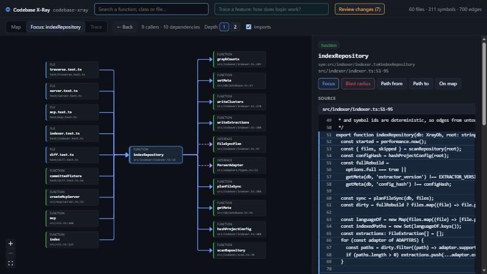
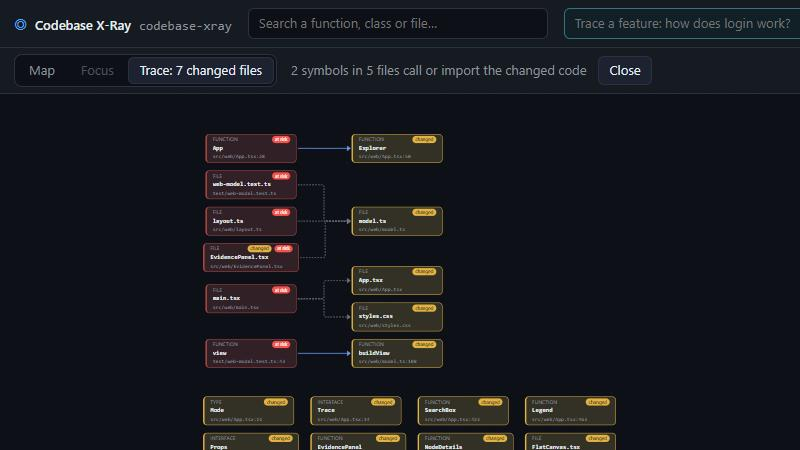

# Codebase X-Ray

[](https://github.com/Alseiari971/codebase-xray/actions/workflows/ci.yml)

**AI can build your software. Now understand what it built.**

Codebase X-Ray turns a repository into an interactive map of how it actually works: architecture, dependencies, feature flows, and change impact. Every relationship on the map traces back to exact source lines. The same local evidence graph serves a browser UI and an MCP server, so you and your coding agent work from the same facts.

> **Status: MVP complete.** `xray ./my-project` indexes a TypeScript/JavaScript repository and opens an interactive map. Click any node or edge for the exact source lines behind it, and ask "how does login work?" to trace a feature. Before you commit, uncommitted changes light up amber and everything that calls or imports them lights up red. `xray mcp` gives your coding agent read access to the same evidence graph, with the same ids. With an API key, AI explains a traced flow while citing that evidence. `xray export` writes a README-ready architecture report.



## Quick start

Requires Node.js 20.6 or newer.

```bash
git clone https://github.com/Alseiari971/codebase-xray.git
cd codebase-xray
npm install
npm run xray -- ../my-project
```

Then open http://localhost:4173. To put `xray` on your PATH, run `npm link` once.

## Commands

| Command | What it does | Status |
| --- | --- | --- |
| `xray <path>` | Index, then serve the map | Working |
| `xray index <path>` | Build or refresh the evidence graph in `<path>/.xray/index.db` | Working |
| `xray serve <path>` | Local web UI and HTTP/JSON API on `localhost` | Working |
| `xray diff [path]` / `xray --uncommitted` | Uncommitted changes, the symbols they touch, and what depends on them | Working |
| `xray flow "<question>" [path]` | Trace a feature from the symbols its words name | Working |
| `xray impact <target> [path]` | Blast radius of a file, symbol name or node id | Working |
| `xray mcp <path>` | Read-only MCP server (stdio) for Claude Code, Cursor, Windsurf and other agents | Working |
| `xray ask "<question>" [path]` | AI explanation of a feature, grounded in and citing the traced evidence (bring your own key) | Working |
| `xray export [path]` | Architecture report: `--format md` (default, with a Mermaid diagram) or `json` (graph snapshot) | Working |

Options: `--db <file>` to store the index somewhere else, `--full` to re-extract every file, `--port <n>` for `serve`, `--base <ref>` for `diff`, `--depth <n>` for how many hops `diff`, `flow` and `impact` follow, `--direction upstream|downstream|both` for `impact`, `--provider` and `--model` for `ask`, `--format md|json` and `--out <file>` for `export`.

```text
$ xray index ./excalidraw
Indexed 926 files in 17578 ms (926 added, 0 updated, 0 unchanged, 0 removed; 389 skipped as unsupported).
Parsed 710 files.
Graph: 10 clusters, 4322 symbols, 4334 import edges, 11115 call edges, 83 external modules.
```

```text
$ xray flow "how does login work?"
Keywords: login
Traced 9 nodes from 2 entry points (calls, up to 5 hops):
  handleLogin  src/api/routes.ts:3
  └─ login  src/auth/login.ts:9
     ├─ hashPassword  src/auth/hash.ts:3
     │  └─ bcrypt  (npm package)
     ├─ UserRepository  src/db/user-repository.ts:6
     └─ UserRepository.findByEmail  src/db/user-repository.ts:7
        └─ UserRepository.query  src/db/user-repository.ts:11
  LoginForm  src/ui/LoginForm.tsx:5
  └─ Button  src/ui/LoginForm.tsx:1
```

```text
$ xray diff
1 file changed, 1 symbol touched (against HEAD):
  M src/auth/hash.ts
      hashPassword

Impact: 2 symbols in 3 files across 2 clusters call or import the changed code (up to 3 hops):
  1  src/auth/login.ts  login
  2  src/api/routes.ts  handleLogin
  3  src/api/server.js  (file-level)
```

```text
$ xray impact hashPassword
Blast radius of hashPassword  src/auth/hash.ts:3 (upstream, up to 4 hops):
  2 symbols in 3 files across 2 clusters depend on it.
  1  src/auth/login.ts  login
  2  src/api/routes.ts  handleLogin
  3  src/api/server.js  (file-level)
```

## Ask AI (optional)

The core never needs a model. When one is configured, `xray ask` and the **Explain with AI** button on a traced feature explain the flow in prose. The model sees only the evidence the deterministic tracer found: the entry points, traced nodes, edges with their evidence ids, and a few source snippets. It never sees the whole repository.

```bash
export OPENAI_API_KEY=...        # or ANTHROPIC_API_KEY, GEMINI_API_KEY, or OLLAMA_HOST for a local model
xray ask "how does login work?" ./my-project
```

- **Providers.** The first configured of `ANTHROPIC_API_KEY`, `OPENAI_API_KEY`, `GEMINI_API_KEY` and `OLLAMA_HOST` is used; pick one with `--provider`. The default models are `claude-opus-5-5`, `gpt-4.1-mini`, `gemini-2.5-flash` and `llama3.1`; change them with `--model` or `XRAY_MODEL`. Requests use plain `fetch` with no SDKs. Claude requests opt into server-side refusal fallbacks.
- **Grounding.** The system prompt requires every claim to cite `[sym:…]`, `[edge:12]` or `[evidence:34]` and to label anything beyond the evidence `Inference:`. Afterwards, every citation in the answer is checked against the evidence package, and citations the model made up are flagged, struck through in the UI.
- **No provider?** You get the deterministic flow trace and a note on which variable to set. Nothing is sent anywhere.

In the UI, each citation is a link: click it to open that node, or the edge and evidence it names.

## Export a report

```bash
xray export ./my-project --out ARCHITECTURE.md       # Markdown with a Mermaid diagram
xray export ./my-project --format json --out graph.json
```

The Markdown report covers:
- repository totals, plus counts of heuristic edges and unresolved imports;
- a Mermaid `graph TD` of cluster dependencies;
- each cluster's largest files, internal dependencies, neighbours and packages;
- entry points (source files nothing else uses), the most depended-on code, and every external package.

GitHub renders the diagram directly. The JSON snapshot is the portable graph: every node, edge (with its evidence ids) and piece of evidence, with repository-relative paths only.

## The UI

`xray serve` shows one canvas and an evidence panel. The canvas never tries to draw the whole graph at once; it has three views.

**Where to start.** On first load, the clusters on the **main execution path** are already open and the path is highlighted. The path runs from the primary entry file (the `bin` or `main` in `package.json`, otherwise the entry file that reaches the most code), through single dependencies, to the few files it relies on most. On this repository that's `bin/xray.js → src/cli.ts →` server, indexer, mcp and report. The panel offers one-click starting points: the main path as a trace, and a **tour** per important folder, each opening that folder's most-used function in Focus (*Tour: indexer → `indexRepository`*). All of it is worked out from the graph, so it works on any repository.

- **Focus** (search for anything, or click *Focus*): the selected function, class or file in the middle, what calls it on the left, and what it calls on the right. Click a neighbour to move the focus there, and use *Back* (or Backspace) to return. Depth 2 adds the next ring. A side with too many neighbours is grouped by file.
- **Trace** shows only the nodes in one result, laid out left to right:
  - *Trace a feature*: ask a question such as *how does checkout work?*; entry points are marked *start* (see [Flow and impact](#flow-and-impact)).
  - *Path from* / *Path to*: the shortest paths between two nodes, or everything downstream of one.
  - *Blast radius*: everything that depends on a node, in red.
  - *Review changes*: your uncommitted edits in amber, and the code that calls or imports them, at risk, in red.
- **Map**: the cluster overview. Each collapsed cluster shows its two most-used functions; click one to focus on it. Press `+` to expand a cluster into files and a file into symbols. Edges stay faint until you click a node, and then only that node's edges stand out. Packages are hidden unless you turn them on.



Click any node for its source lines, and any arrow for each underlying relationship with its trust badge (*Deterministic* or *Heuristic · 70%*), the exact cited lines, and its `edge #` and `evidence #` ids. Lines that moved since indexing are flagged *stale*.

The client is React + [React Flow](https://reactflow.dev), laid out with [dagre](https://github.com/dagrejs/dagre). esbuild bundles it in memory (in about 100 ms) when the server starts, so there is still no build step.

## HTTP API

The server only listens on `127.0.0.1` and rejects requests whose `Host` header isn't `localhost`, which blocks DNS-rebinding attacks from reading your code. Types for every response are in [`src/shared/api-types.ts`](src/shared/api-types.ts).

| Endpoint | Returns |
| --- | --- |
| `GET /api/graph` | Every node (clusters, files, symbols, externals) and edge, with metadata |
| `GET /api/overview` | Entry points, the main execution path, guided tours and each cluster's top functions |
| `GET /api/node/:id/evidence` | The node's source lines, read from disk using its stored line range |
| `GET /api/edge/:id/evidence` | The cited lines for each piece of evidence behind an edge |
| `POST /api/flow` | `{ from, to?, maxDepth?, relations?, limit? }` returns the shortest paths, or everything downstream without `to`. `{ question }` returns the matched entry points and their traced flow. |
| `POST /api/impact` | `{ ids, direction?, maxDepth?, relations? }` returns the blast radius: affected nodes with their distance, grouped by file |
| `GET /api/ai` | Which AI provider and model `POST /api/ask` would use, if any |
| `POST /api/ask` | `{ question, provider?, model? }` returns the grounded answer, its checked citations, the evidence package, and the deterministic trace |
| `GET /api/diff?base=<ref>` | Uncommitted changes (staged, unstaged, untracked), the symbols whose lines they touch (flagged `git-changed`), and the blast radius of those changes |

## Flow and impact

All traversal is deterministic and runs in SQLite as recursive CTEs ([`src/graph/traverse.ts`](src/graph/traverse.ts)), so the browser, the CLI and, later, the MCP server get identical answers. `UNION` removes repeated (node, depth) rows, so cycles stop at the depth limit. Starting from a file or cluster starts from everything inside it.

- **Questions.** The question's words are split and stemmed ("indexing" also matches `indexRepository`), then matched against symbol and file names. Matches that no other match calls become the entry points, preferring functions and classes over types. Everything they call is traced from there. No LLM is involved, so an unmatched word simply matches nothing.
- **Blast radius** walks `upstream` (what depends on a node, i.e. what a change could break) or `downstream` (what it depends on) and groups the result by file and cluster.
- **Diff review.** `git diff --unified=0` hunks are overlapped with symbol line ranges in a single SQL query. The changed nodes are recorded in the `git_changes` table, flagged `git-changed`, with their changed lines. Their blast radius starts from the innermost changed symbols: editing a method's body impacts the method's callers, not every user of its class. A file itself counts as changed only when the edit is outside every symbol, or the file was deleted.

## Connect your coding agent

`xray mcp <path>` runs a read-only [MCP](https://modelcontextprotocol.io) server over stdio for the repository at `<path>`. It indexes on start and re-indexes changed files before answering (at most every 3 s), so the agent always sees the code as it is now, including its own edits. It never writes to your repository; only the `.xray/` index is updated.

**Claude Code**

```bash
claude mcp add xray -- node /path/to/codebase-xray/bin/xray.js mcp /path/to/your-project
```

**Cursor** (`.cursor/mcp.json`) and **Windsurf** (`~/.codeium/windsurf/mcp_config.json`)

```json
{
  "mcpServers": {
    "xray": {
      "command": "node",
      "args": ["/path/to/codebase-xray/bin/xray.js", "mcp", "/path/to/your-project"]
    }
  }
}
```

| Tool | What the agent gets |
| --- | --- |
| `get_architecture_clusters` | Clusters with file and symbol counts, their largest files, which clusters depend on which, and the packages each uses |
| `trace_flow` | `{ question }` such as "how does checkout work?", or `{ from, to? }`: entry points, nodes, and edges with resolution type and evidence |
| `get_blast_radius` | `{ target, direction?, maxDepth? }`: what calls or imports a file, symbol or package, grouped by file and distance |
| `get_node_evidence` | `{ target }`: the node's numbered source lines and its edges with evidence. `{ edgeId }`: every piece of evidence behind one edge. |
| `get_changed_nodes` | `{ base? }`: uncommitted changes mapped to `git-changed` symbols, plus what they could break |

Targets can be node ids, file paths, symbol names (`login`, `UserRepository.findByEmail`) or package names (`bcrypt`).

**Shared truth.** The tools are thin wrappers over the same SQLite queries as the web UI, so they return the same ids. Node ids are shown under each node's title in the evidence panel, and edges and evidence show `edge #12` and `evidence #34`. When an agent says "`sym:src/auth/login.ts#login` calls `hashPassword` (edge #8, evidence #15 at `src/auth/login.ts:12`)", you can find exactly that in the browser. `test/mcp.test.ts` checks this: for the same questions, the MCP tools and the HTTP API return identical node, edge and evidence ids.

## How indexing works

No LLM or API key is involved. Everything comes from the TypeScript compiler.

1. **Scan.** Walk the repository, honouring every `.gitignore` (nested ones too) and always skipping `.git/`, `node_modules/`, `.xray/`, framework build output (`.next/`, `.nuxt/`, `.svelte-kit/`, …) and minified files. Each file gets a SHA-256 `content_hash`.
2. **Parse.** Load the project with [ts-morph](https://ts-morph.com), using the root `tsconfig.json` or `jsconfig.json` so path aliases like `@/lib/db` resolve. JavaScript is parsed too.
3. **Extract symbols.** Functions (including `const fn = () => {}`), classes and their methods, interfaces, type aliases, enums and exported variables become `symbol` nodes under their file, each with its line range.
4. **Extract edges.**
   - `imports`: `import`, `export … from`, dynamic `import()` and `require()`, to repository files (including stylesheets) or to `external` nodes for npm packages (`ext:npm:react`) and Node builtins (`ext:node:fs`).
   - `calls`: function and method calls, `new` expressions and JSX elements, resolved with the type checker from the enclosing symbol (or the file, at module top level) to the declaration.
5. **Cluster.** Group files into 5–10 folder clusters. Top-level folders come first, a folder holding most of the code (`src/`, `packages/`) is split into its subfolders, and the smallest folders fold into `(other)` if there are too many.

Every edge links to `evidence`: the file, line range and parser rule (`ts-morph:call-expression`, `ts-morph:import-declaration`, …) that justify it, plus a hash of those lines. Edges resolved through the type checker are `deterministic` with confidence 1. A call through an interface member (`notifier.send()`) is `heuristic` with confidence 0.7 and points at the interface, because which implementation runs is only known at runtime. Imports that cannot be resolved are kept in the file's `metadata.unresolvedImports` rather than guessed.

**Incremental re-indexing.** Only files whose `content_hash` changed are re-extracted, together with the files that have edges into them, since their edges may now point at renamed or moved symbols. Adding a file also re-checks files with unresolved imports. Changing `tsconfig.json`, `jsconfig.json` or `package.json` triggers a full re-extraction. On excalidraw, a one-file edit re-indexes in about 2.6 s, compared with 17.6 s for a full run.

**Known limitations.**
- Only the root `tsconfig.json` is read, so aliases defined in a nested package's config won't resolve.
- Calls on CommonJS `module.exports` objects are not tracked.
- Files over 1 MB are not parsed.

## Evidence graph

The schema lives in [`src/db/schema.sql`](src/db/schema.sql) and follows section 11 of the project blueprint.

| Table | Purpose | Key columns |
| --- | --- | --- |
| `nodes` | Clusters, files, symbols, datastores, external services | `id`, `parent_id` (zoom hierarchy: cluster → file → symbol → member), `layer`, `type`, `name`, `path`, `symbol`, `language`, `start_line`, `end_line`, `content_hash`, `metadata` |
| `edges` | Relationships such as `imports`, `calls`, `defines-route`, `reads-table` | `source`, `target`, `relation`, `resolution_type`, `confidence` (0 to 1) |
| `evidence` | Exact source ranges that justify an edge | `file_path`, `start_line`, `end_line`, `rule`, `excerpt_hash` |
| `edge_evidence` | Links each edge to one or more pieces of evidence | `edge_id`, `evidence_id` |
| `git_changes` | Nodes flagged `git-changed` by the latest diff (a snapshot, replaced on every diff) | `node_id`, `relation`, `status`, `base`, `ranges` |
| `meta` | Index facts: repository root, last indexed time | `key`, `value` |

Node ids are readable and stable across runs: `cluster:src/auth`, `file:src/auth/login.ts`, `sym:src/auth/login.ts#login`, `sym:src/db/repo.ts#UserRepository.findByEmail`, `ext:npm:bcrypt`.

`layer` is one of `cluster | file | symbol | datastore | external`. `resolution_type` is one of `deterministic | heuristic | runtime_observed | ai_inferred` and drives the trust badge on every edge. Deleting a node cascades to its children, its edges and their evidence links.

## Development

```bash
npm test           # node:test suite (schema, clustering, adapter, indexer, diff, traversal, overview, server API, MCP, AI, export, UI model and layout, CLI)
npm run typecheck  # tsc --noEmit
```

The sources run directly through [tsx](https://tsx.is), so there is no build step. `better-sqlite3` is pinned to `12.9.0` because it is the newest release with prebuilt Windows binaries for Node 20, 22 and 24. That means `npm install` doesn't need a C++ toolchain.

## Roadmap

- [x] **Phase 1: Foundation.** CLI skeleton, SQLite schema, incremental file indexing
- [x] **Phase 2: AST indexer.** ts-morph adapter for symbols, imports and the call graph with evidence, plus folder clusters
- [x] **Phase 3: Local server and UI.** HTTP/JSON API, React Flow map with an evidence panel, flow tracing, and the git diff overlay
- [x] **Phase 4: Diff review and flow tracing.** Recursive-CTE traversal, question-driven feature tracing, blast radius, and `git-changed` flags with change impact
- [x] **Phase 5: MCP server.** Read-only stdio tools `get_architecture_clusters`, `trace_flow`, `get_blast_radius`, `get_node_evidence` and `get_changed_nodes`, sharing ids with the UI
- [ ] Framework adapters: routes (`defines-route`), database access (`reads-table` / `writes-table`), env config
- [x] **Grounded AI explanations.** `xray ask`, `POST /api/ask` and *Explain with AI*: bring your own key (Anthropic, OpenAI, Gemini or Ollama), cited evidence, checked citations
- [x] **Report export.** Markdown with a Mermaid cluster diagram, and the JSON graph snapshot
- [ ] SVG export of the current view
