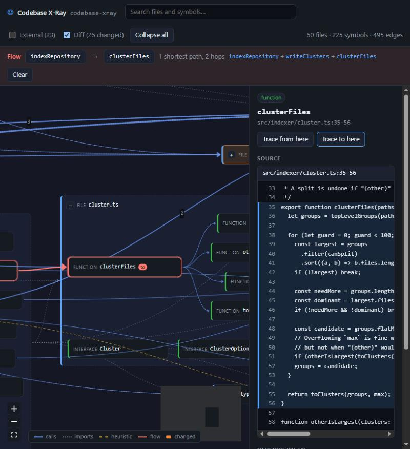

# Codebase X-Ray

[](https://github.com/Alseiari971/codebase-xray/actions/workflows/ci.yml)

**AI can build your software. Now understand what it built.**

Codebase X-Ray turns a repository into an interactive map of how it actually works: architecture, dependencies, feature flows, and change impact. Every relationship on the map traces back to exact source lines. The same local evidence graph serves a browser UI and an MCP server, so you and your coding agent work from the same facts.

> **Status: Phase 3 (local server and UI).** `xray ./my-project` indexes a TypeScript/JavaScript repository and opens an interactive map in your browser. Click any node or edge to see the exact source lines behind it, trace paths between nodes, and see uncommitted changes highlighted. The MCP server is still to come (see [Roadmap](#roadmap)).



## Quick start

Requires Node.js 20.6 or newer.

```bash
git clone https://github.com/Alseiari971/codebase-xray.git
cd codebase-xray
npm install
npm run xray -- ../my-project
```

Then open http://localhost:4173. To put `xray` on your PATH, run `npm link` once.

## Commands

| Command | What it does | Status |
| --- | --- | --- |
| `xray <path>` | Index, then serve the map | Working |
| `xray index <path>` | Build or refresh the evidence graph in `<path>/.xray/index.db` | Working |
| `xray serve <path>` | Local web UI and HTTP/JSON API on `localhost` | Working |
| `xray diff [path]` / `xray --uncommitted` | List uncommitted changes and the symbols they touch | Working |
| `xray mcp <path>` | Read-only MCP server for Claude Code, Cursor, Windsurf, etc. | Planned |

Options: `--db <file>` to store the index somewhere else, `--full` to re-extract every file, `--port <n>` for `serve`, `--base <ref>` for `diff`.

```text
$ xray index ./excalidraw
Indexed 926 files in 17578 ms (926 added, 0 updated, 0 unchanged, 0 removed; 389 skipped as unsupported).
Parsed 710 files.
Graph: 10 clusters, 4322 symbols, 4334 import edges, 11115 call edges, 83 external modules.
```

```text
$ xray diff
3 files changed, 3 symbols touched (against HEAD):
  D src/auth/hash.ts
      hashPassword
  ? src/auth/otp.ts  [index stale]
  M src/db/user-repository.ts  [index stale]
      UserRepository
      UserRepository.findByEmail
Some files changed since the last index; run `xray index` for exact symbol mapping.
```

## The map

`xray serve` puts the graph canvas on the left and the evidence panel on the right.

- **Zoom by expanding.** The map opens on folder clusters. Press `+` or double-click to expand a cluster into its files and a file into its symbols. Edges roll up to whatever is visible, so a collapsed cluster still shows what it depends on, with a count of the underlying edges.
- **Evidence on click.** Click a node for its own source lines: a symbol's range with a little context, a file's contents, or every line that imports an external package. Click an edge for each underlying relationship, with its trust badge (*Deterministic* or *Heuristic · 70%*) and the exact cited lines. Lines that moved since indexing are flagged *stale*.
- **Flow tracing.** Use *Trace from here* and *Trace to here* to light up the shortest paths between two nodes, or *Show downstream* for everything a node reaches.
- **Diff overlay.** Files and symbols with uncommitted changes are marked Δ, and collapsed clusters show how many changes they contain.
- **Search** files and symbols by name, then jump straight to them.

The client is React + [React Flow](https://reactflow.dev) with a nested [dagre](https://github.com/dagrejs/dagre) layout. esbuild bundles it in memory (in about 100 ms) when the server starts, so there is still no build step.

## HTTP API

The server only listens on `127.0.0.1` and rejects requests whose `Host` header isn't `localhost`, which blocks DNS-rebinding attacks from reading your code. Types for every response are in [`src/shared/api-types.ts`](src/shared/api-types.ts).

| Endpoint | Returns |
| --- | --- |
| `GET /api/graph` | Every node (clusters, files, symbols, externals) and edge, with metadata |
| `GET /api/node/:id/evidence` | The node's source lines, read from disk using its stored line range |
| `GET /api/edge/:id/evidence` | The cited lines for each piece of evidence behind an edge |
| `POST /api/flow` | `{ from, to?, maxDepth?, relations?, limit? }` returns the shortest paths, or everything downstream without `to` |
| `GET /api/diff?base=<ref>` | Uncommitted changes (staged, unstaged, untracked), mapped to files and the symbols whose lines they touch |

## How indexing works

No LLM or API key is involved. Everything comes from the TypeScript compiler.

1. **Scan.** Walk the repository, honouring every `.gitignore` (nested ones too) and always skipping `.git/`, `node_modules/`, `.xray/`, framework build output (`.next/`, `.nuxt/`, `.svelte-kit/`, …) and minified files. Each file gets a SHA-256 `content_hash`.
2. **Parse.** Load the project with [ts-morph](https://ts-morph.com), using the root `tsconfig.json` or `jsconfig.json` so path aliases like `@/lib/db` resolve. JavaScript is parsed too.
3. **Extract symbols.** Functions (including `const fn = () => {}`), classes and their methods, interfaces, type aliases, enums and exported variables become `symbol` nodes under their file, each with its line range.
4. **Extract edges.**
   - `imports`: `import`, `export … from`, dynamic `import()` and `require()`, to repository files (including stylesheets) or to `external` nodes for npm packages (`ext:npm:react`) and Node builtins (`ext:node:fs`).
   - `calls`: function and method calls, `new` expressions and JSX elements, resolved with the type checker from the enclosing symbol (or the file, at module top level) to the declaration.
5. **Cluster.** Group files into 5–10 folder clusters. Top-level folders come first, a folder holding most of the code (`src/`, `packages/`) is split into its subfolders, and the smallest folders fold into `(other)` if there are too many.

Every edge links to `evidence`: the file, line range and parser rule (`ts-morph:call-expression`, `ts-morph:import-declaration`, …) that justify it, plus a hash of those lines. Edges resolved through the type checker are `deterministic` with confidence 1. A call through an interface member (`notifier.send()`) is `heuristic` with confidence 0.7 and points at the interface, because which implementation runs is only known at runtime. Imports that cannot be resolved are kept in the file's `metadata.unresolvedImports` rather than guessed.

**Incremental re-indexing.** Only files whose `content_hash` changed are re-extracted, together with the files that have edges into them, since their edges may now point at renamed or moved symbols. Adding a file also re-checks files with unresolved imports. Changing `tsconfig.json`, `jsconfig.json` or `package.json` triggers a full re-extraction. On excalidraw, a one-file edit re-indexes in about 2.6 s, compared with 17.6 s for a full run.

**Known limitations.**
- Only the root `tsconfig.json` is read, so aliases defined in a nested package's config won't resolve.
- Calls on CommonJS `module.exports` objects are not tracked.
- Files over 1 MB are not parsed.

## Evidence graph

The schema lives in [`src/db/schema.sql`](src/db/schema.sql) and follows section 11 of the project blueprint.

| Table | Purpose | Key columns |
| --- | --- | --- |
| `nodes` | Clusters, files, symbols, datastores, external services | `id`, `parent_id` (zoom hierarchy: cluster → file → symbol → member), `layer`, `type`, `name`, `path`, `symbol`, `language`, `start_line`, `end_line`, `content_hash`, `metadata` |
| `edges` | Relationships such as `imports`, `calls`, `defines-route`, `reads-table` | `source`, `target`, `relation`, `resolution_type`, `confidence` (0 to 1) |
| `evidence` | Exact source ranges that justify an edge | `file_path`, `start_line`, `end_line`, `rule`, `excerpt_hash` |
| `edge_evidence` | Links each edge to one or more pieces of evidence | `edge_id`, `evidence_id` |
| `meta` | Index facts: repository root, last indexed time | `key`, `value` |

Node ids are readable and stable across runs: `cluster:src/auth`, `file:src/auth/login.ts`, `sym:src/auth/login.ts#login`, `sym:src/db/repo.ts#UserRepository.findByEmail`, `ext:npm:bcrypt`.

`layer` is one of `cluster | file | symbol | datastore | external`. `resolution_type` is one of `deterministic | heuristic | runtime_observed | ai_inferred` and drives the trust badge on every edge. Deleting a node cascades to its children, its edges and their evidence links.

## Development

```bash
npm test           # node:test suite (schema, clustering, adapter, indexer, diff, server API, UI model and layout, CLI)
npm run typecheck  # tsc --noEmit
```

The sources run directly through [tsx](https://tsx.is), so there is no build step. `better-sqlite3` is pinned to `12.9.0` because it is the newest release with prebuilt Windows binaries for Node 20, 22 and 24. That means `npm install` doesn't need a C++ toolchain.

## Roadmap

- [x] **Phase 1: Foundation.** CLI skeleton, SQLite schema, incremental file indexing
- [x] **Phase 2: AST indexer.** ts-morph adapter for symbols, imports and the call graph with evidence, plus folder clusters
- [x] **Phase 3: Local server and UI.** HTTP/JSON API, React Flow map with an evidence panel, flow tracing, and the git diff overlay
- [ ] Framework adapters: routes (`defines-route`), database access (`reads-table` / `writes-table`), env config
- [ ] Blast-radius queries and downstream impact for diffs
- [ ] `xray mcp`: read-only MCP tools (`get_architecture_clusters`, `trace_flow`, `get_blast_radius`, `get_node_evidence`, `get_changed_nodes`)
- [ ] Grounded AI explanations (optional, bring your own key)
- [ ] Exports: SVG, JSON, Markdown
